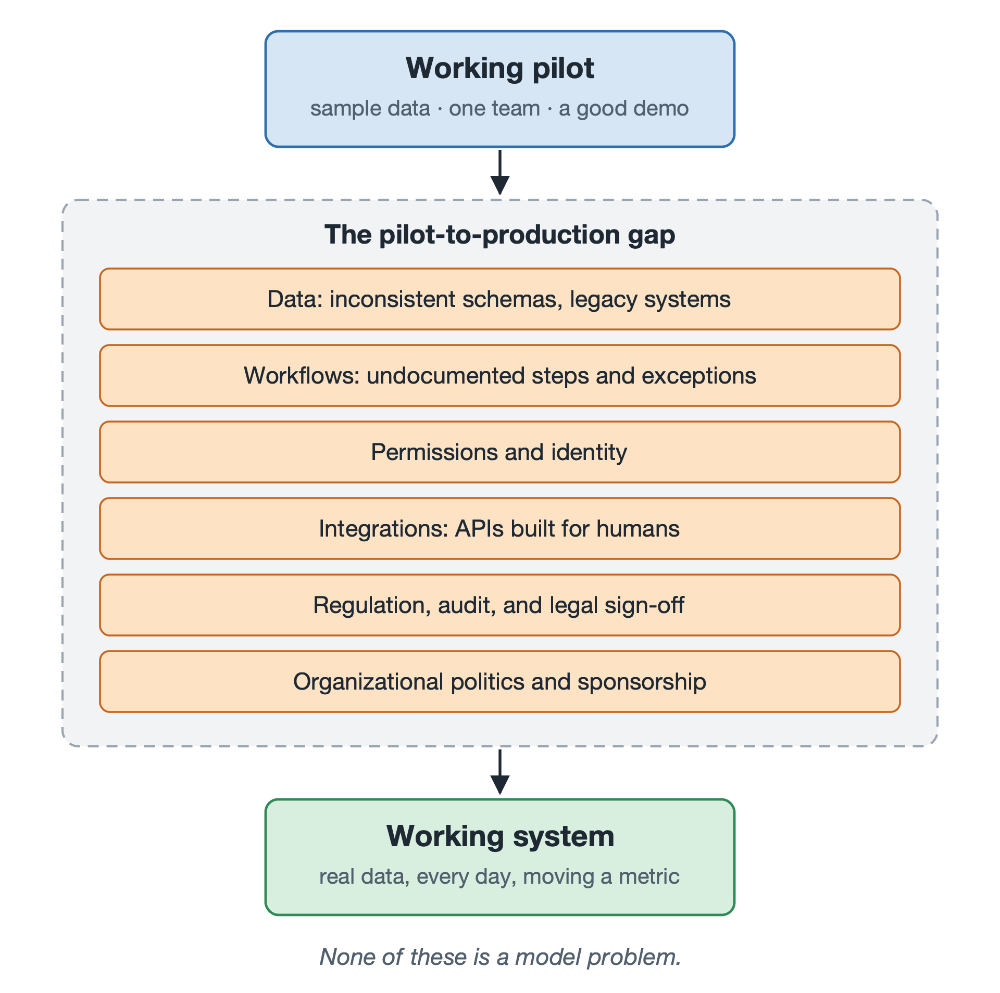

# Forward Deployed AI Engineering: companion repository

Templates, prompts, an eval harness, figures and references for the book ***Forward Deployed AI Engineering: The Forward Deployed Engineer (FDE) Guide to Shipping Enterprise AI from Pilot to Production*** by [Nasser Ghanemzadeh](https://ghanemzadeh.com), published by Packt.

Everything here is meant to be copied and adapted. You do not need the book to use it, though each file says which chapter explains it.

## What is in this repository

| Folder | What you get |
|---|---|
| [templates/](templates/) | The twelve working templates from the book: week-one checklist, scoping document, contract outline, weekly status update, post-engagement synthesis, discovery interview script, eval rubric with a worked example, interview prep, portfolio README, first-slice layout and trace schema |
| [prompts/](prompts/) | The LLM-judge grading prompt and the rubric it grades against, from Chapter 9 |
| [eval-harness/](eval-harness/) | A small Python eval harness you can run: deterministic checks, a model judge, judge-versus-human calibration, and a dashboard. It has 36 tests and runs without an API key |
| [figures/](figures/) | The nine diagrams from the book in color, as SVG and PNG |
| [references/](references/) | All 114 sources the book cites, with links, and a further-reading list by theme |

## Quick start

To use a template, open it in [templates/](templates/), copy it, and fill in the brackets.

To run the eval harness (Python 3.10 or later):

```bash
git clone https://github.com/ghanemzadeh/ai-fde.git
cd ai-fde/eval-harness
python -m venv .venv && source .venv/bin/activate
pip install -r requirements.txt
python run.py --dry-run
```

The dry run grades six invented contract-review memos against a rubric and reports which ones fail and why. See the [harness README](eval-harness/README.md) for how to point it at your own system.

## What is a Forward Deployed AI Engineer?

A Forward Deployed Engineer (FDE) is an engineer who works inside a customer's organization and writes the production code that makes a vendor's product work for that customer. Bob McGrew, who helped build the role at Palantir, defines it as an engineer "who sits at the customer site and fills the gap between what the product does and what the customer needs" ([source](references/references.md#ref-21)).

A Forward Deployed AI Engineer does that job for AI systems. The work is part engineering and part discovery: finding the real problem, agreeing with the customer on what good output looks like, shipping a narrow working slice on real data, and getting it through the customer's data, identity, governance and audit requirements.

The role is different from the jobs it is often confused with. A solutions architect designs and recommends. A sales engineer supports the sale. A customer success manager looks after the account. An FDE ships code into production and is accountable for whether it works.

## Why the role exists: the pilot-to-production gap

The MIT NANDA report *The GenAI Divide* found that 95 percent of enterprise generative AI pilots produced no measurable return ([source](references/references.md#ref-1)). The book argues that the cause is deployment, not the models. Six layers sit between a pilot that works and a system that works: data, workflows, permissions and identity, integrations, regulation and audit, and organizational politics.



Closing that gap is the Forward Deployed Engineer's job.

## The frameworks in the book

| Framework | In one sentence | Chapter | Here |
|---|---|---|---|
| Pilot-to-Production Gap | The gap between a working demo and a working system is a deployment problem | 1 | [Figure 1.1](figures/README.md) |
| Echo and Delta | One half of the craft learns the customer's domain and finds what is broken; the other builds the fix | 5 | [Figure 5.1](figures/README.md) |
| Scope, Validate, Deliver | Validation is its own phase and ends in a gate: no delivery commitment until an agreed threshold is cleared | 6 | [Scoping document](templates/A02-scoping-document.md) |
| Gravel Road to Paved Highway | Customer-specific work becomes product when the recurring pattern is generalized once | 7 | [Synthesis template](templates/A06-post-engagement-synthesis.md) |
| Map before you automate | Sort every step of a process into delete, plain code, agent, or human decision before building | 8 | [Figure 8.2](figures/README.md) |
| Evals as Specification | The eval set is the specification and the model is only the implementation | 9 | [Eval harness](eval-harness/) |
| Outcome pricing | The contract is part of the engineering: milestones, consumption, or a share of the value | 17 | [Contract outline](templates/A04-engagement-contract-outline.md) |

## Chapter by chapter

| Chapter | Material in this repository |
|---|---|
| 1. The Pilot-to-Production Gap | [Figure 1.1](figures/README.md) |
| 2. Defining the Forward Deployed AI Engineer | [References](references/references.md) |
| 3. A Brief History: From Palantir to the Frontier Labs | [Further reading: foundational sources](references/further-reading.md) |
| 4. The Founder-Mode Operator | [Figure 4.1](figures/README.md) |
| 5. Echo and Delta: Two Halves of One Craft | [Figure 5.1](figures/README.md) |
| 6. Scope, Validate, Deliver: The Three-Phase Engagement | [Week-one checklist](templates/A01-week-one-checklist.md), [scoping document](templates/A02-scoping-document.md), [Figure 6.1](figures/README.md) |
| 7. Gravel Road to Paved Highway | [Post-engagement synthesis](templates/A06-post-engagement-synthesis.md), [Figure 7.1](figures/README.md) |
| 8. Discovery: Diagnosing the Real Problem | [Discovery interview script](templates/A07-discovery-interview-script.md), [Figures 8.1 and 8.2](figures/README.md) |
| 9. Evals as Specification | [Rubric template](templates/A08-eval-rubric-template.md), [worked example](templates/A08-eval-rubric-worked-example.md), [judge prompt](prompts/llm-judge-grading-prompt.md), [eval harness](eval-harness/), [Figure 9.1](figures/README.md) |
| 10. Shipping the First Slice | [First-slice repository layout](templates/ch10-slice-repo-layout.md) |
| 11. Integrating with the Enterprise Stack | [Further reading: enterprise integration and governance](references/further-reading.md) |
| 12. Closing the Loop: Telemetry, Feedback, and Iteration | [Trace schema](templates/ch12-trace-schema.md), [weekly status update](templates/A05-weekly-status-update.md) |
| 13. The Paths In: From SWE, Consulting, PM, Founder | [Further reading: hiring and compensation](references/further-reading.md) |
| 14. Building a Portfolio That Lands the Role | [Portfolio README template](templates/A10-portfolio-readme-template.md) |
| 15. The FDE Interview Loop | [Mock interview prep](templates/A09-mock-interview-prep.md) |
| 16. Year One on the Inside | [Weekly status update](templates/A05-weekly-status-update.md) |
| 17. Pricing, Outcomes, and Contracts | [Engagement contract outline](templates/A04-engagement-contract-outline.md), [Figure 17.1](figures/README.md) |
| 18. Cargo Cults and Failure Modes | [References](references/references.md) |
| 19. The FDE Diaspora and What's Next | [References](references/references.md) |
| 20. A Note for the Buyer | [Engagement contract outline](templates/A04-engagement-contract-outline.md) |
| Appendix A. Workbook | [templates/](templates/) and [eval-harness/](eval-harness/) |
| Appendix B. References | [references/references.md](references/references.md) |
| Appendix C. Further Reading by Theme | [references/further-reading.md](references/further-reading.md) |

## Who the book is for

- **Early-career engineers** who have read the job postings, recognize how they want to work, and want a map.
- **Mid-career switchers**: consultants, solutions architects, product managers and former founders who suspect they have most of the skills and want to know what is missing.
- **Founders and hiring managers** building an FDE function for the first time.

By the last chapter you should be able to explain the role in your own words, describe an engagement from the first customer conversation to production, run the first week of a real engagement with these templates, and plan a path from your current job to a first offer.

## About the book

The book has five parts and twenty chapters.

- **Part I, The Landscape.** What the role is, where it came from, and why AI made it a default operating model.
- **Part II, The Mindset and the Method.** The founder-mode operator, Echo and Delta, the three-phase engagement, and how engagement work compounds into product.
- **Part III, The Craft.** Discovery, evals, shipping the first slice, enterprise integration, and closing the loop.
- **Part IV, Becoming an FDE.** The paths in, the portfolio, the interview loop, and the first year.
- **Part V, Economy and Future.** Pricing and contracts, failure modes, where FDEs go next, and a chapter for the buyer.

*Forward Deployed AI Engineering* is published by Packt.

## Errata and questions

Found an error in the book, a broken link, or a bug in the harness? [Open an issue](https://github.com/ghanemzadeh/ai-fde/issues/new/choose). See [CONTRIBUTING.md](CONTRIBUTING.md).

## How to cite

> Ghanemzadeh, Nasser. *Forward Deployed AI Engineering: The Forward Deployed Engineer (FDE) Guide to Shipping Enterprise AI from Pilot to Production.* Packt Publishing, 2026.

GitHub's "Cite this repository" button gives the same citation in BibTeX and APA.

## Licence

- The code in `eval-harness/` is under the [MIT License](LICENSE).
- The templates, prompts, figures and lists are © Nasser Ghanemzadeh. You may use and adapt them in your own work, including commercial work. You may not republish them as a collection. See [LICENSE-CONTENT.md](LICENSE-CONTENT.md).

## About the author

Nasser Ghanemzadeh is a Forward Deployed AI Engineer for founder-led B2B SaaS companies. Through his firm, Eupraxic, he runs the FDE Sprint, a ten-business-day engagement that ships one narrow AI workflow into a customer's product, with an evaluation rubric written before the code and scored on the customer's own data.

He writes at [ghanemzadeh.com](https://ghanemzadeh.com) and publishes a weekly [newsletter](https://ghanemzadeh.com/newsletter).
