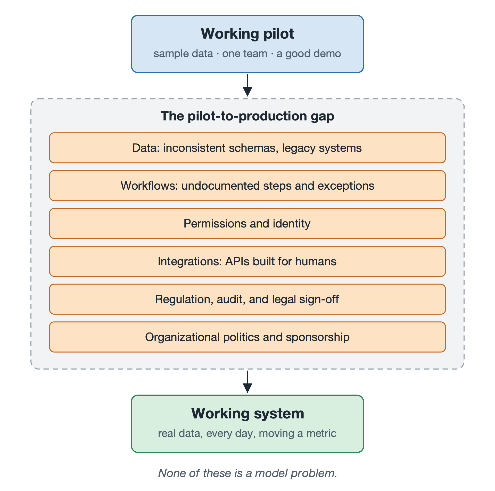
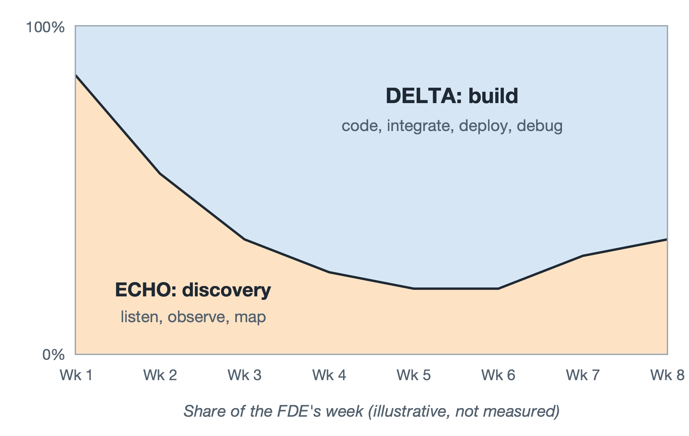
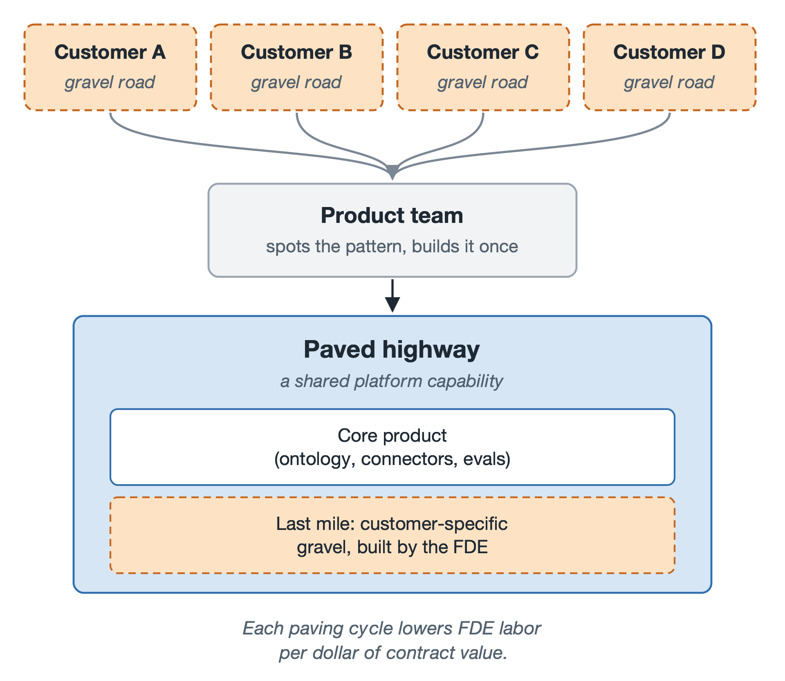
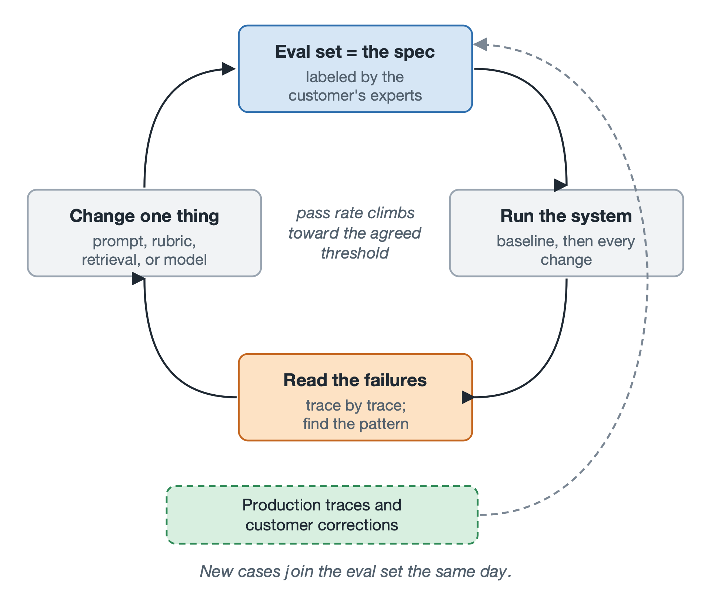
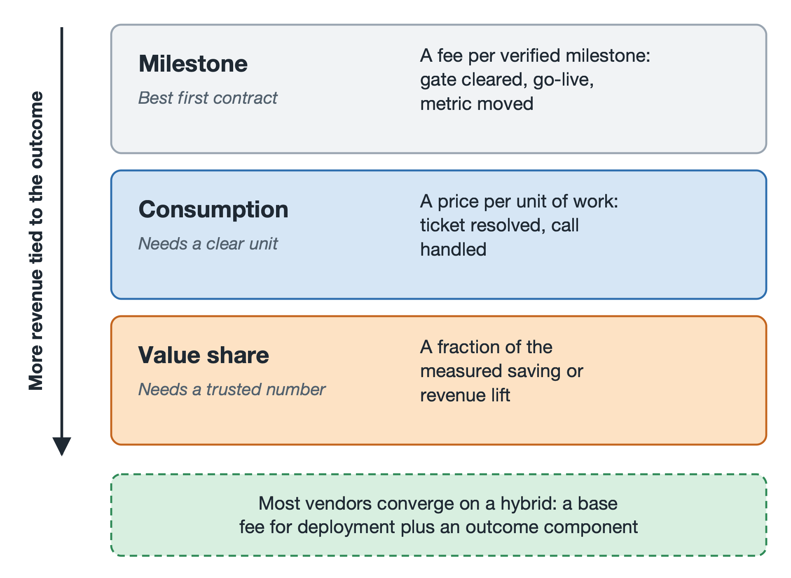

# Figures

The nine diagrams from *Forward Deployed AI Engineering*, in color. Each is a PNG file.

## Figure 1.1

The pilot-to-production gap. Six layers separate a working pilot from a working system, and every one of them is a deployment problem, not a model problem.

## Figure 4.1

Technical and commercial skill as two axes. The FDE sits where both are high. Concept after Jamie Signorile; drawing by the author.

## Figure 5.1

How the mix of Echo and Delta work shifts across an eight-week engagement. The shape is illustrative, not measured.

## Figure 6.1

Scope, Validate, Deliver. Validation is its own phase, and it ends in a gate: no delivery commitment until the agreed threshold is cleared.

## Figure 7.1

Gravel roads become a paved highway. FDEs build customer-specific paths, the product team generalizes the recurring pattern once, and the next customer needs gravel only for the last mile.

## Figure 8.1

The documented process and the one the work actually follows. Most of the elapsed time sits in the waits between steps and in rework loops the documentation never shows. The example is generic; it draws on Michael Hammer's idea and on Moza's documented-versus-actual comparison.

## Figure 8.2

Sorting each mapped step before anything is built. The four buckets follow Moza; the decision questions and examples are the author's.

## Figure 9.1

The eval loop. The eval set is the specification; every change is judged against it, and production traces keep adding cases.

## Figure 17.1

Three contract structures, ordered by how much of the vendor's revenue rides on the customer's measured outcome.

## Use

The figures are © Nasser Ghanemzadeh. You may use them in your own talks, notes and internal documents with credit to the book. See [LICENSE-CONTENT.md](../LICENSE-CONTENT.md).
